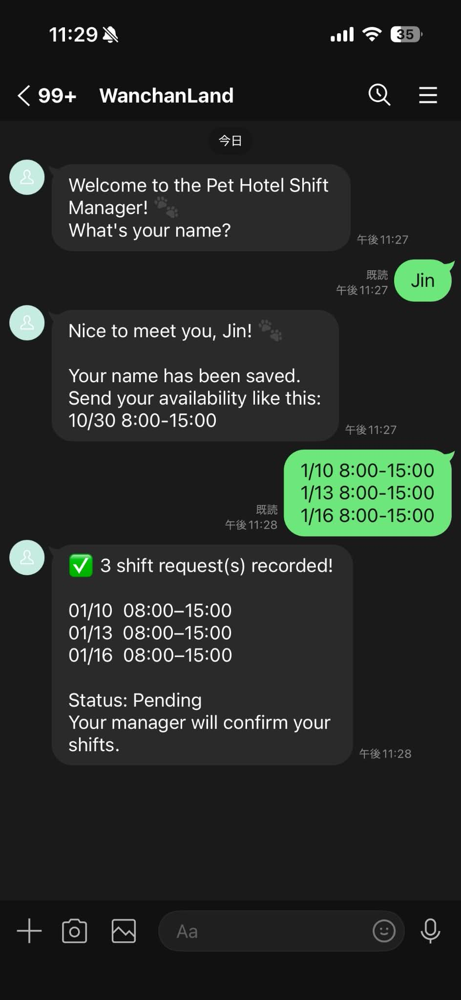

# Pet Hotel Shift Management System
A shift management system developed using Google Apps Script, Google Sheets and LINE Messaging API.

## Overview
An independently developed shift management system designed to improve shift request and scheduling operations at a small pet hotel business.

## Background
Through my part-time work at a pet hotel, I noticed inefficiencies in the traditional shift request process, where staff submitted their availability manually and the owner managed the schedules by hand.

To address this issue, I planned and developed a system that allows staff to submit shift requests through LINE and enables the manager to manage schedules using Google Sheets.

## Features
- Submit shift requests through LINE
- Record shift requests automatically in Google Sheets
- Manage and review submitted shift requests
- Approve staff shifts
- Display approved shifts in a monthly calendar

## System Used
- Google Apps Script
- Google Sheets
- LINE Messaging API

## My Role
Independently responsible for:
- Identifying operational issues
- Planning system functionality
- Developing the system
- Testing and improving features

## Screenshots

### LINE Shift Submission
Staff can submit their desired working dates and hours through LINE.

### Shift Requests
Submitted shift requests are automatically recorded in Google Sheets.

### Monthly Calendar
Displays approved shifts in a monthly calendar, allowing staff to easily view their work schedules.

## Project Status
Personal development project currently undergoing testing and improvements.
